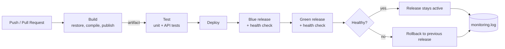
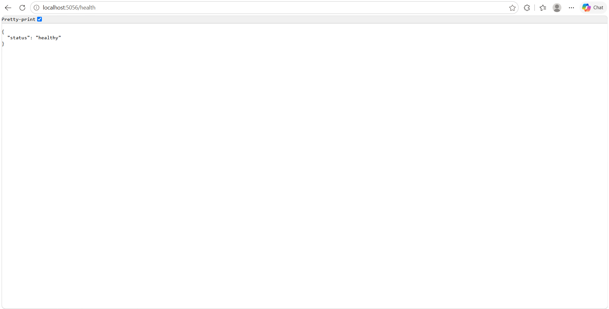
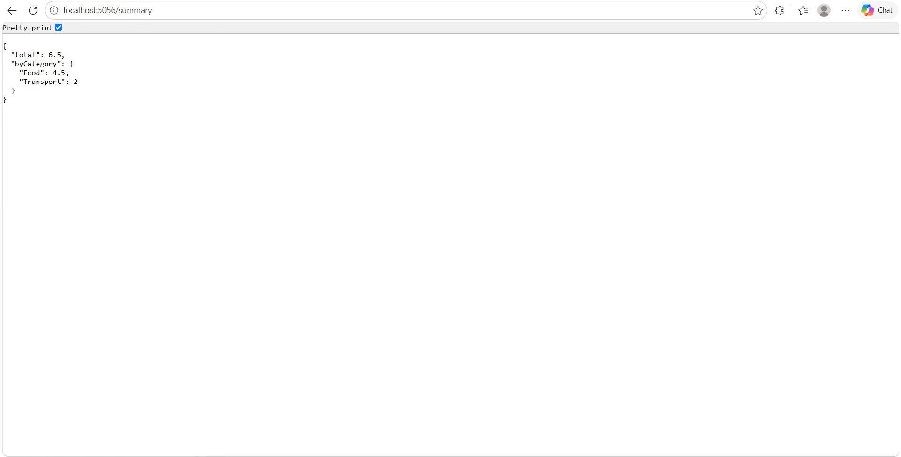

# ExpenseTracker DevOps

ხარჯების აღრიცხვის მარტივი REST API (C#, ASP.NET Core Minimal API, .NET 10) სრული CI/CD პაიპლაინით GitHub Actions-ზე.

## პროექტის აღწერა

აპლიკაცია საშუალებას იძლევა დავამატოთ ხარჯები (აღწერა, თანხა, კატეგორია) და ვნახოთ ჯამები კატეგორიების მიხედვით.

| Endpoint | აღწერა |
|---|---|
| `GET /health` | აპლიკაციის ჯანმრთელობის შემოწმება |
| `GET /expenses` | ყველა ხარჯის სია |
| `POST /expenses` | ახალი ხარჯის დამატება (ვალიდაციით) |
| `GET /summary` | საერთო ჯამი და ჯამი კატეგორიების მიხედვით |

**ინსტრუმენტები:** C#, .NET 10, ASP.NET Core, xUnit, Git/GitHub, GitHub Actions, Bash სკრიპტები.

## ბრენჩები

- `dev` — მიმდინარე დამუშავება
- `main` — სტაბილური ვერსია (ცვლილებები `dev`-იდან Pull Request-ით შედის)

## CI/CD პროცესი

Workflow ეშვება ყოველ `push`-ზე და Pull Request-ზე `main` და `dev` ბრენჩებზე (`.github/workflows/ci-cd.yml`). შედგება 3 საფეხურისგან:

1. **Build** — .NET-ის დაყენება, dependencies-ის restore, კომპილაცია და publish (`scripts/build.sh`). შედეგი ინახება artifact-ად.
2. **Test** — unit და HTTP API ტესტების გაშვება (`scripts/test.sh`).
3. **Deploy** — ლოკალური Blue-Green დეპლოიმენტი `production/` საქაღალდეში (`scripts/deploy.sh`):
   - პირველი დეპლოი `blue` სლოტზე, შემდეგ გადართვა `green`-ზე;
   - ყოველი დეპლოის შემდეგ health check (`scripts/monitor.sh`), შედეგი იწერება `production/monitoring.log`-ში;
   - უარყოფითი health check-ის შემთხვევაში ავტომატური **rollback**: ახალი ვერსია ჩერდება და მუშა ვერსია აქტიური რჩება;
   - ლოგები იტვირთება artifact-ად.

### Workflow diagram



## სქრინშოტები

### წარმატებით გავლილი სამსაფეხურიანი პაიპლაინი
GitHub Actions-ში Build, Test და Deploy საფეხურები წარმატებით სრულდება.


### Unit ტესტების გაშვება
ყველა ტესტი (unit და HTTP API) წარმატებით გადის.


### მომუშავე აპლიკაცია
`/health` endpoint აპლიკაციის სტატუსს აბრუნებს.



`/summary` endpoint აჩვენებს ჯამებს კატეგორიების მიხედვით.



## ლოკალურად გაშვება

```bash
dotnet build
dotnet test
dotnet run --project src/ExpenseTracker
```

## მონიტორინგი

`scripts/monitor.sh` ამოწმებს `/health` endpoint-ს `curl`-ით და შედეგს (HEALTHY/UNHEALTHY, დრო, HTTP კოდი) ამატებს `production/monitoring.log` ფაილში. Rollback-ის შემთხვევაში იქვე იწერება `ROLLBACK` ჩანაწერი.
