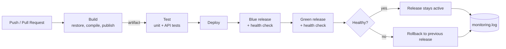
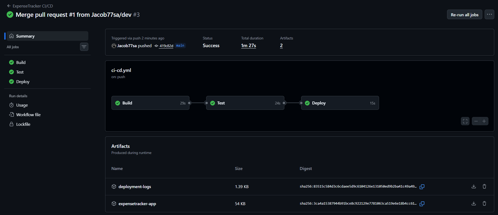
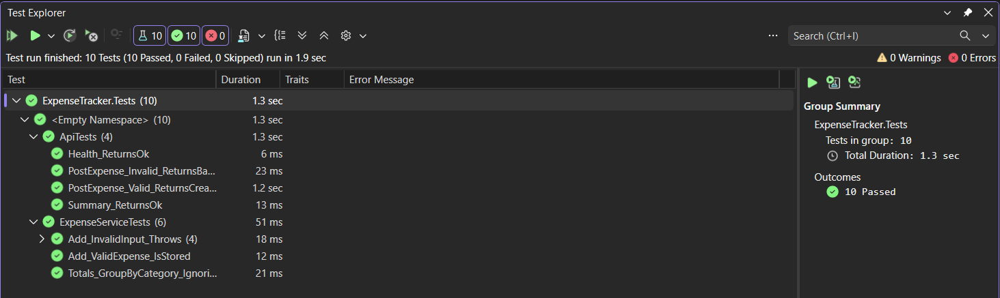
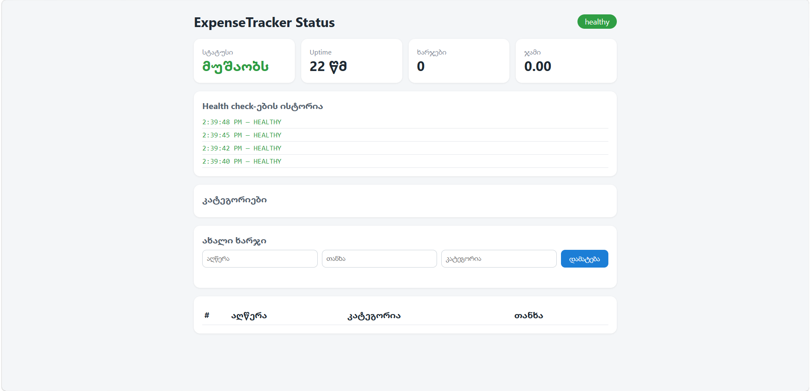
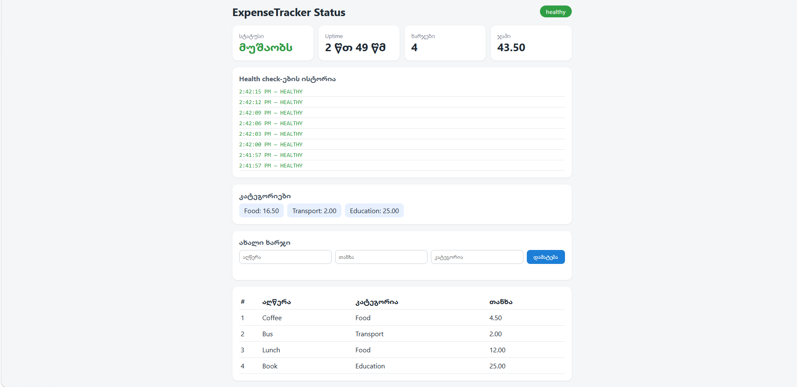
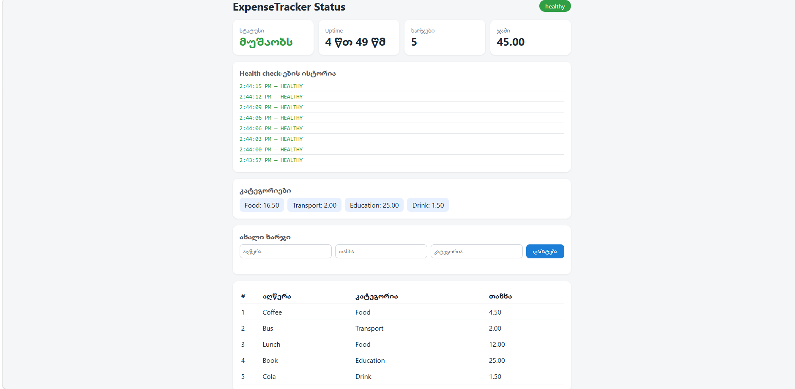
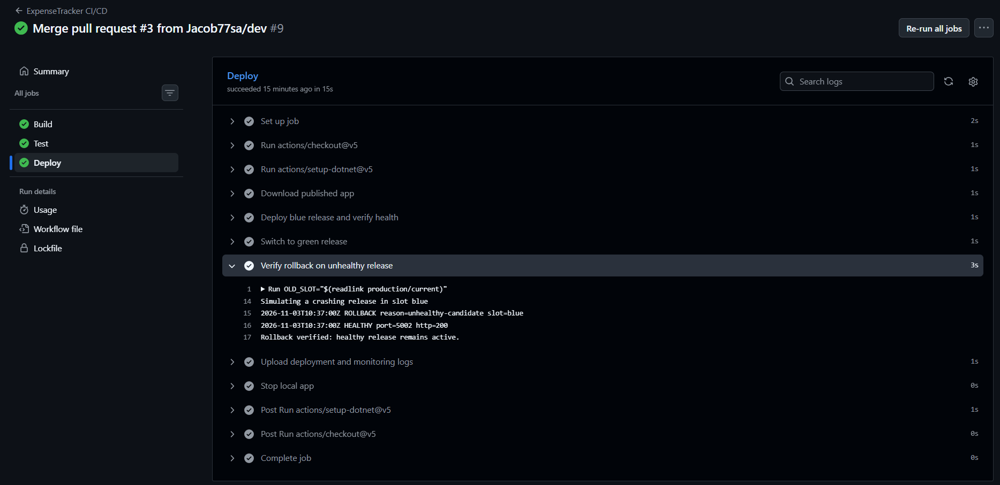

# ExpenseTracker DevOps

ხარჯების აღრიცხვის მარტივი REST API სტატუს-დეშბორდით (C#, ASP.NET Core Minimal API, .NET 10) სრული CI/CD პაიპლაინით GitHub Actions-ზე.

## პროექტის აღწერა

აპლიკაცია საშუალებას იძლევა დავამატოთ ხარჯები (აღწერა, თანხა, კატეგორია) და ვნახოთ ჯამები კატეგორიების მიხედვით. მთავარ გვერდზე მუშაობს ვიზუალური დეშბორდი.

| Endpoint | აღწერა |
|---|---|
| `GET /` | ვიზუალური status დეშბორდი |
| `GET /health` | აპლიკაციის ჯანმრთელობის შემოწმება |
| `GET /status` | uptime, ხარჯების რაოდენობა და ჯამი |
| `GET /expenses` | ყველა ხარჯის სია |
| `POST /expenses` | ახალი ხარჯის დამატება (ვალიდაციით) |
| `GET /summary` | საერთო ჯამი და ჯამი კატეგორიების მიხედვით |

**ინსტრუმენტები:** C#, .NET 10, ASP.NET Core, xUnit, Git/GitHub, GitHub Actions, Bash სკრიპტები.

## ბრენჩები

- `dev` — მიმდინარე დამუშავება
- `main` — სტაბილური ვერსია (ცვლილებები `dev`-იდან Pull Request-ით შედის)

## CI/CD პროცესი

Workflow ეშვება ყოველ `push`-ზე და Pull Request-ზე `main` და `dev` ბრენჩებზე (`.github/workflows/ci-cd.yml`). შედგება 3 საფეხურისგან:

1. **Build** — .NET-ის დაყენება, dependencies-ის restore, კომპილაცია და publish (`scripts/build.sh`). შედეგი ინახება artifact-ად.
2. **Test** — unit და HTTP API ტესტების გაშვება (`scripts/test.sh`).
3. **Deploy** — ლოკალური Blue-Green დეპლოიმენტი `production/` საქაღალდეში (`scripts/deploy.sh`):
   - პირველი დეპლოი `blue` სლოტზე, შემდეგ გადართვა `green`-ზე;
   - ყოველი დეპლოის შემდეგ health check (`scripts/monitor.sh`), შედეგი იწერება `production/monitoring.log`-ში;
   - უარყოფითი health check-ის შემთხვევაში ავტომატური **rollback**;
   - ლოგები იტვირთება artifact-ად.

### Workflow diagram



## სქრინშოტები

### წარმატებით გავლილი სამსაფეხურიანი პაიპლაინი
GitHub Actions-ში Build, Test და Deploy საფეხურები წარმატებით სრულდება.



### Unit ტესტების გაშვება
ყველა ტესტი (unit და HTTP API) წარმატებით გადის.



### მომუშავე აპლიკაცია
აპლიკაციის გაშვების მომენტში ხარჯები ცარიელია, health check-ები კი ავტომატურად ახლდება:



ხარჯების დამატების შემდეგ ახლდება ჯამი, კატეგორიები და ცხრილი:



ახალი კატეგორიის (Drink) დამატების შემდეგ:



## ბონუსი

### ვიზუალური დეშბორდი (status display)

მთავარი გვერდი (`/`) 3 წამში ერთხელ ამოწმებს `/health` და `/status` endpoint-ებს და აჩვენებს: სტატუსის ბეჯს (healthy/offline), uptime-ს, ხარჯების რაოდენობასა და ჯამს, health check-ების ბოლო ისტორიას, კატეგორიების ჯამებს და ხარჯის დამატების ფორმას (იხ. სქრინშოტები ზემოთ).

### ავტომატური Rollback

`scripts/deploy.sh` ყოველ ახალ ვერსიას ცალკე სლოტზე (blue/green) უშვებს და ამოწმებს `/health`-ს. თუ health check უარყოფითია, ახალი ვერსია ჩერდება, `production/monitoring.log`-ში იწერება `ROLLBACK reason=unhealthy-candidate`, ხოლო მუშა ვერსია აქტიური რჩება. workflow-ის ნაბიჯი "Verify rollback on unhealthy release" ამას ყოველ Deploy-ზე ავტომატურად ამოწმებს (იმიტირებული გაუმართავი ვერსიით).



## ლოკალურად გაშვება

```bash
dotnet build
dotnet test
dotnet run --project src/ExpenseTracker
```

## მონიტორინგი

`scripts/monitor.sh` ამოწმებს `/health` endpoint-ს `curl`-ით და შედეგს (HEALTHY/UNHEALTHY, დრო, HTTP კოდი) ამატებს `production/monitoring.log` ფაილში. Rollback-ის შემთხვევაში იქვე იწერება `ROLLBACK` ჩანაწერი.

## Deploy-ის გარემო და მონიტორინგის ლოგი

`production/` საქაღალდე იქმნება GitHub Actions runner-ზე Deploy job-ის დროს (`scripts/deploy.sh`) და განზრახ არ ინახება რეპოში (`.gitignore`). მასში არის `blue/` და `green/` სლოტები, `current` ბმული აქტიურ სლოტზე და `monitoring.log`. ლოგები ყოველ run-ზე იტვირთება artifact-ად (`deployment-logs`).

ლოგის ნიმუში Deploy job-იდან (`monitoring.log`):

```
2026-11-03T11:02:57Z DEPLOYED slot=blue port=5001
2026-11-03T11:02:57Z HEALTHY port=5001 http=200
2026-11-03T11:02:59Z DEPLOYED slot=green port=5002
2026-11-03T11:02:59Z HEALTHY port=5002 http=200
2026-11-03T11:03:02Z ROLLBACK reason=unhealthy-candidate slot=blue
2026-11-03T11:03:02Z HEALTHY port=5002 http=200
```
